# Pre1-1. 개발 워크스테이션 구축

### Linux 터미널 · Docker · Git & GitHub

## 1. 프로젝트 개요 및 실행 환경

### 1-1. 프로젝트 개요

코디세이 AI 올인원 과정의 개발 워크스테이션 구축 미션 수행 기록입니다.

이번 미션에서는 Linux 터미널을 이용한 기본적인 파일 및 디렉터리 관리부터 파일 권한 설정, Docker를 활용한 컨테이너 실행과 이미지 생성, Git 및 GitHub를 이용한 버전 관리까지 개발 환경 구축에 필요한 기본 기술을 학습하고 실습했습니다.

**주요 수행 목표**

- Linux 터미널의 기본 명령어를 활용한 파일 및 디렉터리 관리
- Linux 파일 및 디렉터리 권한의 이해와 변경
- Docker 이미지와 컨테이너의 생성 및 관리
- Dockerfile을 이용한 사용자 정의 이미지 제작
- 포트 매핑을 통한 웹 서버 접속 확인
- Bind Mount와 Volume을 이용한 데이터 연결 및 유지
- Git과 GitHub를 이용한 프로젝트 버전 관리 및 원격 저장소 연동

### 1-2. 개발 환경

| 구분        | 사용 환경              |
| --------- | ------------------ |
| 운영체제      | Windows 11 Home    |
| WSL2 OS  | Ubuntu 24.04.5 LTS (Noble Numbat) |
| 리눅스 커널 | 6.18.54.1 (x86_64 아키텍처) |
| 기본 셸     | Bash         |
| 컨테이너 | Docker 29.9.2 (Docker Desktop 연동) |
| 코드 편집기    | Visual Studio Code |
| 버전 관리/저장소     | Git / GitHub              |

> ⚠️ 환경 주의
> - 출력에 보이는 `/Users/ruav/codyssey_AIO_ruav`는 작성자 PC 경로. 각자 저장소를 내려받은 위치로 바꿔 읽기.
> - 각 섹션은 저장소 루트(`codyssey_AIO_ruav/`)에서 시작.

### 1-3. 수행 항목 체크리스트 

- [ ] **Linux CLI 실습**: 현재 위치·파일 목록(숨김 파일 포함) 확인, 디렉토리 이동, 파일 및 폴더 생성·복사·이동·삭제, 파일 내용 확인
- [ ] **Linux 권한 관리**: `note.txt` 권한을 644 → 600, `backup/` 디렉토리 권한을 755 → 700으로 변경하고 전후 비교
- [ ] **Docker 환경 점검**: Docker 버전 및 엔진 동작 확인, `nginx:alpine` 이미지 다운로드 및 목록 확인
- [ ] **Docker 컨테이너 관리**: hello-world·Ubuntu 컨테이너 실행, 컨테이너 실행·중지·삭제, 로그 및 리소스 확인, `exec`와 `attach` 차이 확인
- [ ] **Dockerfile 및 커스텀 이미지**: `nginx:alpine` 기반 `e1-1-web:1.0` 이미지 빌드, 웹 페이지 복사, LABEL 및 HEALTHCHECK 설정 후 컨테이너 실행
- [ ] **포트 매핑 및 웹 접속**: `-p 8090:80` 설정 후 `curl` 및 웹 브라우저 접속 확인
- [ ] **바인드 마운트**: `e1-1/bind/` 디렉토리를 컨테이너에 연결하고 호스트 파일 수정 전후의 웹 응답 비교
- [ ] **Docker 볼륨**: `e1-1-vol` 생성 및 연결, 컨테이너 삭제 전후 데이터 유지 확인
- [ ] **Git 설정 및 확인**: Git 사용자 이름·이메일 설정, 기본 브랜치 `main` 설정, `git config --list` 결과 확인
- [ ] **GitHub 및 VSCode 연동**: GitHub 로그인, 원격 저장소 연결, 로컬 파일 커밋 및 Push, GitHub 업로드 결과 확인, VSCode 연동 확인

---

## 2. 저장소 구조와 설계 기준

### 2-1. GitHub 저장소 정보

| 구분        | 내용                                                                                                 |
| --------- | -------------------------------------------------------------------------------------------------- |
| 저장소 이름    | `codyssey_AIO_ruav`                                                                                |
| 저장소 주소    | [https://github.com/ruaruadl45/codyssey_AIO_ruav](https://github.com/ruaruadl45/codyssey_AIO_ruav) |
| 주요 관리 파일  | README.md, Dockerfile, app/, docs/evidence/                                                            |

### 2-2. 프로젝트 디렉터리 구조

```text
codyssey_AIO_ruav/
│
├── README.md    
│
└── pre1-1/                
    ├── README.md     
    ├── Dockerfile
    ├── app/
    │   └── index.html
    └── docs/
        └── evidence/
            ├── 01_terminal.png
            ├── 02_permission_*.png
            ├── 03_docker*.png
            ├── 04_container_*.png
            ├── 05_web_server_*.png
            ├── 06_port_mapping_*.png
            ├── 07_bind_mount.png
            ├── 08_volume_*.png
            └── 09_*.png            # Git/GitHub/VSCode 연동
```

| 파일 및 폴더          | 역할                           |
| ---------------- | ---------------------------- |
| `README.md`      | 프로젝트 개요, 수행 내용 및 검증 결과 기록    |
| `Dockerfile`     | 사용자 정의 Docker 이미지 생성 설정      |
| `app/`           | 웹 서버에서 제공할 HTML 파일 보관        |
| `app/index.html` | 웹 페이지 기본 파일                  |
| `docs/evidence/` | 실습 과정 및 결과를 확인할 수 있는 스크린샷 보관 |

### 2-3. 설계 기준

- 프로젝트의 주요 설명과 수행 기록은 `README.md`에 통합합니다.
- Docker 이미지 생성 설정은 `Dockerfile`에서 관리합니다.
- 웹 페이지에 사용되는 파일은 `app/` 디렉터리에서 관리합니다.
- 실습 과정에서 생성한 스크린샷은 `docs/evidence/`에 보관합니다.
- 실제 실행 결과와 검증 자료를 기준으로 수행 여부를 기록합니다.

---

## 3. 기능 요구사항

전체 미션 수행 항목과 검증 방법, 상세 기록 및 증거 자료의 위치를 정리합니다.

| 번호 | 수행 항목                  | 주요 검증 명령어                         | 상세 기록                            | 증거 자료        |
| -- | ---------------------- | --------------------------------- | -------------------------------- | ------------ |
| 1 | Linux CLI 및 파일 관리 | `pwd`, `ls`, `mkdir`, `touch` | [4-1-1](#4-1-1-Linux-기본-명령어-및-파일-관리) | [01_terminal](docs/evidence/01_terminal.png)<br>[01_terminal2](docs/evidence/01_terminal2.png) |
| 2 | 파일 및 디렉터리 권한 | `chmod`, `ls -l` | [4-1-3](#4-1-3-Linux-파일-및-디렉터리-권한) | [02_permission_file](docs/evidence/02_permission_file.png)<br>[02_permission_dir](docs/evidence/02_permission_dir.png) |
| 3 | Docker 설치 및 상태 확인 | `docker --version`, `docker info` | [4-2](#4-2-1-Docker-설치-및-상태-확인) | [03_docker](docs/evidence/03_docker.png) |
| 4 | Docker 컨테이너 관리 | `docker ps`, `docker logs` | [4-2](#4-2-3-컨테이너-및-이미지-정리) | [03_docker_cleanup](docs/evidence/03_docker_cleanup.png) |
| 5 | 컨테이너 실행 | `docker run`, `docker exec` | [4-3](#4-3-컨테이너-실행) | [04_container_hello](docs/evidence/04_container_hello.png)<br>[04_container_ubuntu](docs/evidence/04_container_ubuntu.png)<br>[04_container_attach_exec](docs/evidence/04_container_attach_exec.png) |
| 6 | Dockerfile 및 커스텀 이미지 | `docker build`, `docker images` | [4-4](#4-4-dockerfile-및-커스텀-이미지) | [05_web_server_build](docs/evidence/05_web_server_build.png) |
| 7 | 포트 매핑 및 웹 서버 접속 | `docker ps`, `curl` | [4-5](#4-5-포트-매핑-및-웹-서버-접속) | [06_port_mapping_8080](docs/evidence/06_port_mapping_8080.png)<br>[06_port_mapping_8081](docs/evidence/06_port_mapping_8081.png) |
| 8 | Bind Mount 및 Volume | `docker volume`, `docker inspect` | [4-6](#4-6-바인드-마운트-및-볼륨) | [07_bind_mount](docs/evidence/07_bind_mount.png)<br>[08_volume_novol](docs/evidence/08_volume_novol.png)<br>[08_volume_persist](docs/evidence/08_volume_persist.png) |
| 9 | Git 및 GitHub 연동 | `git status`, `git push` | [4-7](#4-7-git-및-github-연동) | [09_git_config](docs/evidence/09_git_config.png)<br>[09_git_push](docs/evidence/09_git_push.png)<br>[09_vscode_github](docs/evidence/09_vscode_github.png)<br>[09_github_web](docs/evidence/09_github_web.png) |

---

## 4. 수행 내용 및 검증

각 실습은 다음 순서로 정리합니다.

1. 수행 목적
2. 실행 명령어
3. 실행 결과
4. 확인 내용

---

### 4-1. Linux CLI 및 파일 권한

#### 4-1-1. Linux 기본 명령어 및 파일 관리

**수행 목적**

Linux 터미널에서 현재 위치를 확인하고 파일과 디렉터리를 생성, 조회, 수정 및 관리하는 기본 명령어를 익힘.

**실행 명령어**

```bash
whoami
pwd
ls -la                        # 숨김 파일 포함 상세 목록

mkdir practice                # 디렉터리 생성
cd practice                   # 이동
touch note.txt                # 빈 파일 생성
echo "Hello Linux" > note.txt # 내용 쓰기
cat note.txt                  # 내용 확인

cp note.txt note_copy.txt     # 복사
mv note_copy.txt renamed.txt  # 이동 / 이름 변경
mkdir tmpdir
ls -la

rm renamed.txt                # 파일 삭제
rmdir tmpdir                  # 빈 디렉터리 삭제
ls -la
```

**실행 결과**

```text
ruav@DESKTOP-JCSRKLA:~$ whoami
ruav
ruav@DESKTOP-JCSRKLA:~$ pwd
/home/ruav
ruav@DESKTOP-JCSRKLA:~$ mkdir practice
ruav@DESKTOP-JCSRKLA:~$ cd practice
ruav@DESKTOP-JCSRKLA:~/practice$ touch note.txt
ruav@DESKTOP-JCSRKLA:~/practice$ echo "Hello Linux" > note.txt
ruav@DESKTOP-JCSRKLA:~/practice$ cat note.txt
Hello Linux
ruav@DESKTOP-JCSRKLA:~/practice$ cp note.txt note_copy.txt
ruav@DESKTOP-JCSRKLA:~/practice$ mv note_copy.txt renamed.txt
ruav@DESKTOP-JCSRKLA:~/practice$ mkdir tmpdir
ruav@DESKTOP-JCSRKLA:~/practice$ ls -la
total 20
drwxr-xr-x 3 ruav ruav 4096 Nov  4 15:59 .
drwxr-x--- 8 ruav ruav 4096 Nov  4 15:57 ..
-rw-r--r-- 1 ruav ruav   12 Nov  4 15:58 note.txt
-rw-r--r-- 1 ruav ruav   12 Nov  4 15:58 renamed.txt
drwxr-xr-x 2 ruav ruav 4096 Nov  4 15:59 tmpdir
ruav@DESKTOP-JCSRKLA:~/practice$ rm renamed.txt
ruav@DESKTOP-JCSRKLA:~/practice$ rmdir tmpdir
ruav@DESKTOP-JCSRKLA:~/practice$ ls -la
total 12
drwxr-xr-x 2 ruav ruav 4096 Nov  4 15:59 .
drwxr-x--- 8 ruav ruav 4096 Nov  4 15:57 ..
-rw-r--r-- 1 ruav ruav   12 Nov  4 15:58 note.txt
```

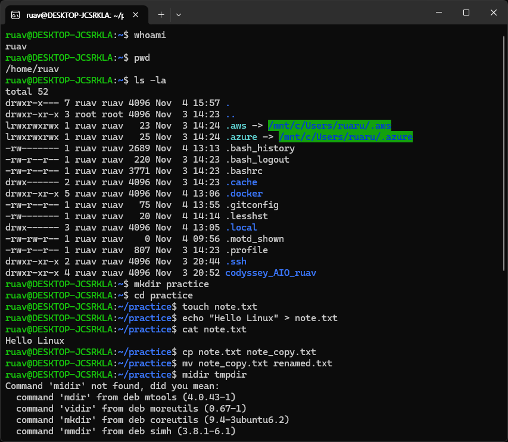

**확인 내용**

- 파일/디렉터리의 생성, 복사, 이름 변경, 삭제가 `ls -la` 목록에 그대로 반영되었다.
- `ls -la`에서 `.`으로 시작하는 숨김 파일을 확인했다.

#### 4-1-2. 절대 경로와 상대 경로

**수행 목적**

같은 파일을 절대 경로와 상대 경로로 각각 지정해 보고, 현재 위치에 따라 결과가 달라지는 차이를 확인.

**실행 명령어** (4-1-1에 이어 `practice` 디렉터리에서 시작)

```bash
pwd                                 # /home/ruav/practice
cat note.txt                        # 상대 경로 (현재 위치 기준)
cat /home/ruav/practice/note.txt    # 절대 경로 (같은 파일)

cd ..
pwd
cat practice/note.txt               # 상대 경로 (위치가 바뀌어 경로도 바뀜)
cat note.txt                        # 현재 위치에 파일이 없어 실패 예상

cd ~
pwd                                 # ~ = /home/ruav
```

**실행 결과**

```text
ruav@DESKTOP-JCSRKLA:~/practice$ pwd
/home/ruav/practice
ruav@DESKTOP-JCSRKLA:~/practice$ cat note.txt
Hello Linux
ruav@DESKTOP-JCSRKLA:~/practice$ cat /home/ruav/practice/note.txt
Hello Linux
ruav@DESKTOP-JCSRKLA:~/practice$ cd ..
ruav@DESKTOP-JCSRKLA:~$ pwd
/home/ruav
ruav@DESKTOP-JCSRKLA:~$ cat practice/note.txt
Hello Linux
ruav@DESKTOP-JCSRKLA:~$ cat note.txt
cat: note.txt: No such file or directory
ruav@DESKTOP-JCSRKLA:~$ cd ~
ruav@DESKTOP-JCSRKLA:~$ pwd
/home/ruav
```
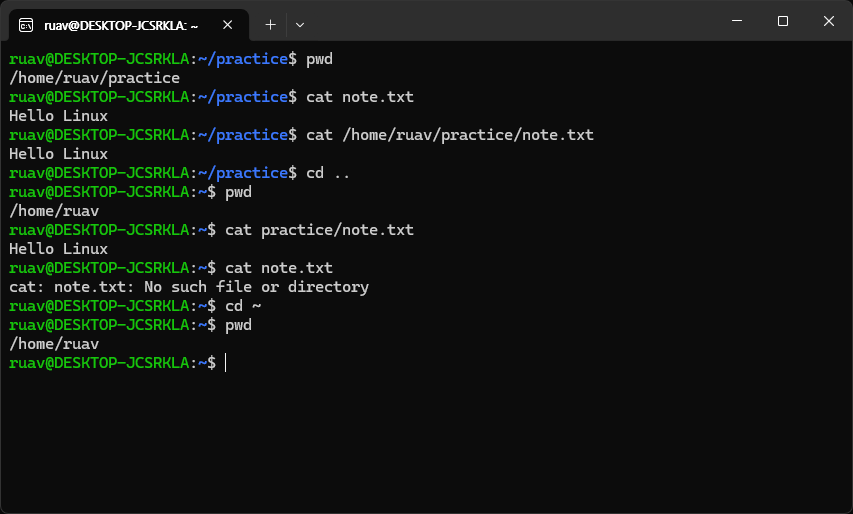

**확인 내용**

- 절대 경로는 현재 위치와 관계없이 같은 파일을 가리키고, 상대 경로는 현재 위치에 따라 가리키는 대상이 달라진다.
- `.`은 현재 디렉터리, `..`은 상위 디렉터리, `~`는 홈 디렉터리를 뜻한다.
- 경로를 선택하는 기준은 [5. 핵심 개념 정리](#5-핵심-개념-정리)에서 설명한다.

#### 4-1-3. Linux 파일 및 디렉터리 권한

**수행 목적**

`chmod`로 파일과 디렉터리의 권한을 바꾸고, 변경 전/후를 비교해 r/w/x와 755, 644 표기를 이해.

**권한 설정 대상**

- 소유자(User)
- 그룹(Group)
- 기타 사용자(Other)

**권한의 종류**

| 기호 | 의미          | 숫자 |
| -- | ----------- | -- |
| r  | 읽기(Read)    | 4  |
| w  | 쓰기(Write)   | 2  |
| x  | 실행(Execute) | 1  |

**권한 숫자의 의미**

| 권한  | 소유자        | 그룹     | 기타 사용자 |
| --- | ---------- | ------ | ------ |
| 755 | 읽기, 쓰기, 실행 | 읽기, 실행 | 읽기, 실행 |
| 644 | 읽기, 쓰기     | 읽기     | 읽기     |
| 700 | 읽기, 쓰기, 실행 | 권한 없음  | 권한 없음  |

**실행 명령어**

```bash
# 파일: 변경 전 → 후
cd ~/practice
echo 'echo script ran' > script.sh
ls -l script.sh               # 변경 전 (실행 권한 없음)
./script.sh                   # Permission denied 예상
chmod +x script.sh
ls -l script.sh               # 변경 후 (x 추가)
./script.sh                   # 실행 성공

chmod 644 note.txt && ls -l note.txt
chmod 755 script.sh && ls -l script.sh

# 디렉터리: 변경 전 → 후
cd ~
ls -ld practice               # 변경 전
chmod 700 practice
ls -ld practice               # 변경 후 (drwx------)
chmod 000 practice
cd practice                   # Permission denied 예상 (진입에는 x 필요)
chmod 755 practice            # 원래대로 복구

# 기본 권한 규칙
umask                         # 보통 0022
touch umask_file && mkdir umask_dir
ls -ld umask_file umask_dir   # 기본 권한 확인
rm umask_file && rmdir umask_dir
```

**실행 결과**

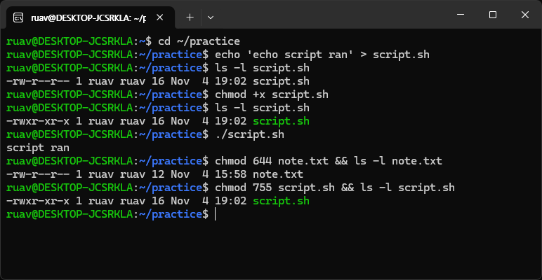
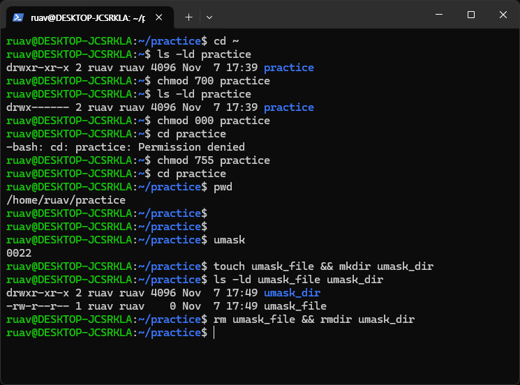

**확인 내용**

- `chmod`로 권한을 변경하고, `ls -l`은 파일 권한을, `ls -ld`는 디렉터리 자체의 권한을 확인한다.
- `r=4`, `w=2`, `x=1`을 소유자/그룹/기타별로 더해 3자리로 표기한다. `644`는 `rw-r--r--`, `755`는 `rwxr-xr-x`, `700`은 `rwx------`이다.
- 실행 권한(`x`)이 없는 스크립트는 실행되지 않고, 디렉터리는 `x`가 없으면 `cd`로 들어갈 수 없다. 
- 새 파일은 기본 `666`, 디렉터리는 `777`에서 `umask`(022)를 뺀 `644`, `755`가 된다. (실제 `umask` 값: `[022]`)

---

### 4-2. Docker 점검·운영·정리

#### 4-2-1. Docker 설치 및 상태 확인

**수행 목적**

Docker가 정상적으로 설치되어 있는지 확인하고 Docker 실행 환경의 상태를 점검.

**실행 명령어**

```bash
# Docker 버전 확인
docker --version

# Docker 실행 환경 정보 확인
docker info
```
**실행 결과**

```text
ruav@DESKTOP-JCSRKLA:~$ docker --version
Docker version 29.9.2, build a82e528
ruav@DESKTOP-JCSRKLA:~$ docker info
Client:
 Version:    29.9.2
 Context:    default
 Debug Mode: false
 Plugins:
 .. 생략 .. 
 Server:
 Containers: 5
  Running: 2
  Paused: 0
  Stopped: 3
 Images: 3
 Server Version: 29.9.2
 .. 생략 .. 
```

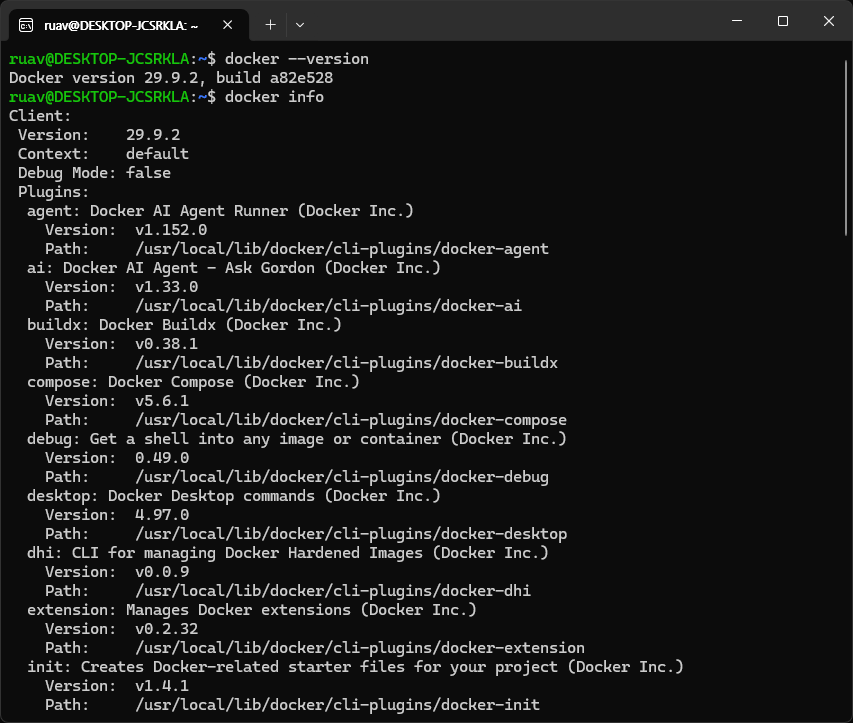

**확인 내용**

- `docker --version`으로 설치된 버전을 확인했다.
- `docker info`에 서버(데몬) 정보가 출력되므로 Docker 엔진이 동작 중이다.

#### 4-2-2. Docker 이미지·컨테이너 목록, 로그, 자원 확인

**수행 목적**

이미지와 컨테이너의 상태를 확인하고, 실행 중인 컨테이너의 로그와 자원 사용량을 확인.

**실행 명령어**

```bash
docker images                 # 이미지 목록
docker ps                     # 실행 중인 컨테이너
docker ps -a                  # 종료된 컨테이너 포함 전체

docker logs confident_ganguly # 로그 확인
docker stats --no-stream      # CPU/메모리 사용량
```

**실행 결과**

```text
ruav@DESKTOP-JCSRKLA:~$ docker images
                                                                       i Info →   U  In Use
IMAGE                 ID             DISK USAGE   CONTENT SIZE   EXTRA
hello-world:latest    c567b231f656       25.9kB         9.49kB    U
my-custom-nginx:1.0   ee9343c65b3c       93.6MB         26.3MB    U
ubuntu:latest         6a06111c3b0a        163MB         45.9MB    U
ruav@DESKTOP-JCSRKLA:~$ docker ps
CONTAINER ID   IMAGE                 COMMAND                  CREATED       STATUS       PORTS                                     NAMES
9fd3afcb538a   my-custom-nginx:1.0   "/docker-entrypoint.…"   3 hours ago   Up 3 hours   0.0.0.0:8080->80/tcp, [::]:8080->80/tcp   web-8080
dd00c8013b01   ubuntu                "bash"                   3 hours ago   Up 3 hours                                             ubuntu-test
ruav@DESKTOP-JCSRKLA:~$ docker ps -a
CONTAINER ID   IMAGE                 COMMAND                  CREATED        STATUS                    PORTS                                     NAMES
9fd3afcb538a   my-custom-nginx:1.0   "/docker-entrypoint.…"   3 hours ago    Up 3 hours                0.0.0.0:8080->80/tcp, [::]:8080->80/tcp   web-8080
dd00c8013b01   ubuntu                "bash"                   3 hours ago    Up 3 hours                                                          ubuntu-test
ef9de4af58b5   hello-world           "/hello"                 3 hours ago    Exited (0) 3 hours ago                                              confident_ganguly
.. 생략 .. 
ruav@DESKTOP-JCSRKLA:~$ docker logs confident_ganguly

Hello from Docker!
This message shows that your installation appears to be working correctly.
.. 생략 .. 
ruav@DESKTOP-JCSRKLA:~$ docker stats --no-stream
CONTAINER ID   NAME          CPU %     MEM USAGE / LIMIT     MEM %     NET I/O           BLOCK I/O        PIDS
9fd3afcb538a   web-8080      0.00%     12.87MiB / 7.601GiB   0.17%     4.08kB / 3.85kB   0B / 12.3kB      17
dd00c8013b01   ubuntu-test   0.00%     10.64MiB / 7.601GiB   0.14%     1.34kB / 126B     20.8MB / 4.1kB   1
```

**확인 내용**

- `docker ps`는 실행 중인 컨테이너만, `docker ps -a`는 `Exited` 상태까지 보여 준다.
- `docker logs`에서 웹 서버 접속 기록을, `docker stats`에서 컨테이너별 자원 사용량을 확인했다.

#### 4-2-3. 컨테이너 및 이미지 정리

**수행 목적**

실습 과정에서 생성한 컨테이너와 이미지를 정리하는 방법을 익힘.

**실행 명령어**

```bash
docker ps -a                                   # 정리 전
docker stop web-8080 ubuntu-test               # 실행 중인 컨테이너 중지
docker rm web-8080 ubuntu-test confident_ganguly mybox pedantic_bell  # 모든 컨테이너 삭제
docker rm $(docker ps -aq --filter ancestor=hello-world) 2>/dev/null || true # (참고용 안전 삭제)
docker rmi hello-world my-custom-nginx:1.0     # 불필요한 이미지 삭제
docker volume prune -f                         # 사용하지 않는 볼륨 정리 (선택)
docker ps -a && docker images                  # 정리 후
```

※ 실제로 만든 이름만 지웁니다. `web-8080`과 `my-custom-nginx:1.0`은 재현 검증을 위해 남겨 둡니다.

**실행 결과**

```text
ruav@DESKTOP-JCSRKLA:~$ docker ps -a
CONTAINER ID   IMAGE                 COMMAND                  CREATED        STATUS                     PORTS     NAMES
9fd3afcb538a   my-custom-nginx:1.0   "/docker-entrypoint.…"   3 hours ago    Exited (0) 3 minutes ago             web-8080
dd00c8013b01   ubuntu                "bash"                   4 hours ago    Up 4 hours                           ubuntu-test
ef9de4af58b5   hello-world           "/hello"                 4 hours ago    Exited (0) 4 hours ago               confident_ganguly
409f96bca97c   ubuntu                "/bin/bash"              26 hours ago   Exited (0) 19 hours ago              mybox
d0ab67f5abf5   hello-world           "/hello"                 26 hours ago   Exited (0) 26 hours ago              pedantic_bell
.. 생략 .. 
ruav@DESKTOP-JCSRKLA:~$ docker ps -a && docker images
CONTAINER ID   IMAGE     COMMAND   CREATED   STATUS    PORTS     NAMES
                                                                       i Info →   U  In Use
IMAGE           ID             DISK USAGE   CONTENT SIZE   EXTRA
ubuntu:latest   6a06111c3b0a        163MB         45.9MB
```

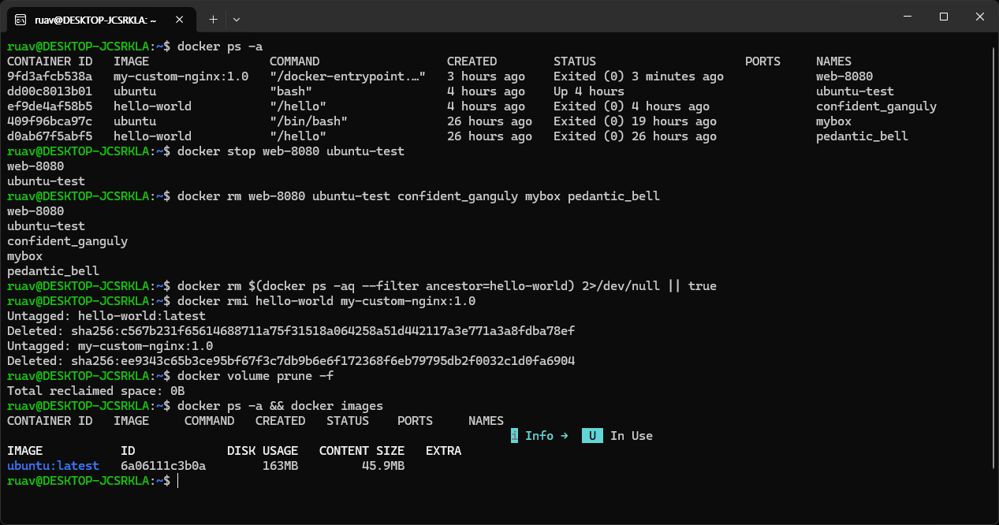

**확인 내용**

- 실행 중인 컨테이너는 `stop` 후 `rm`으로 삭제한다.
- `docker rm`(컨테이너)과 `docker rmi`(이미지)는 서로 다른 작업이다.

---

### 4-3. 컨테이너 실행

#### 4-3-1. Hello World 컨테이너 실행

**수행 목적**

Docker가 이미지를 내려받아 컨테이너를 정상 실행하는지 확인.

**실행 명령어**

```bash
docker run hello-world
```

**실행 결과**

```text
[실제 출력 입력]
```

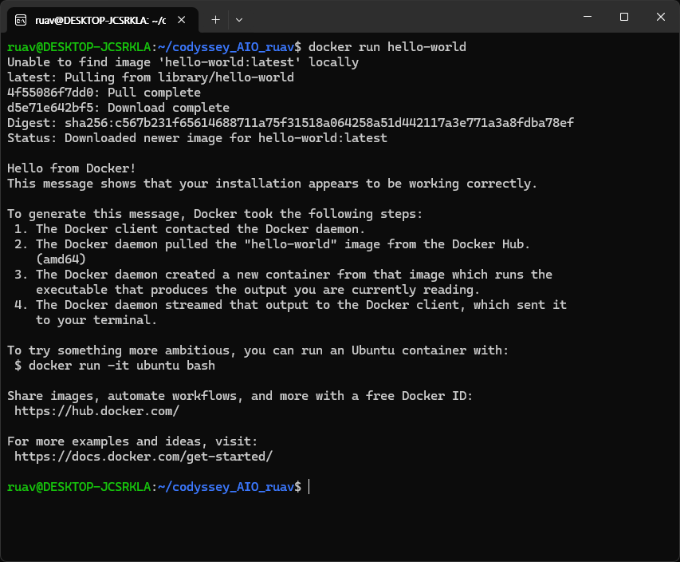

**확인 내용**

- 이미지를 내려받고 컨테이너가 실행되어 안내 메시지가 출력되었다.

#### 4-3-2. Ubuntu 컨테이너 실행

**수행 목적**

Ubuntu 컨테이너 내부에 진입해 Linux 명령을 실행.

**실행 명령어**

```bash
docker run -it --name ubuntu-test ubuntu bash

# 컨테이너 내부에서
whoami
pwd
ls
echo "hello from container"
exit

# 호스트에서
docker ps -a                  # ubuntu-test 상태 확인
```

**실행 결과**

```text
ruav@DESKTOP-JCSRKLA:~/codyssey_AIO_ruav$ docker run -it --name ubuntu-test ubuntu bash
root@a1a6512d2796:/# whoami
root
root@a1a6512d2796:/# pwd
/
root@a1a6512d2796:/# ls
bin   dev  home  lib64  mnt  proc  run   srv  tmp  var
boot  etc  lib   media  opt  root  sbin  sys  usr
root@a1a6512d2796:/# echo "hello from container"
hello from container
root@a1a6512d2796:/# exit
exit
ruav@DESKTOP-JCSRKLA:~/codyssey_AIO_ruav$ docker ps -a
CONTAINER ID   IMAGE         COMMAND    CREATED          STATUS                     PORTS     NAMES
a1a6512d2796   ubuntu        "bash"     48 seconds ago   Exited (0) 4 seconds ago             ubuntu-test
3dbd881dcdb7   hello-world   "/hello"   2 minutes ago    Exited (0) 2 minutes ago             nervous_lalande
```

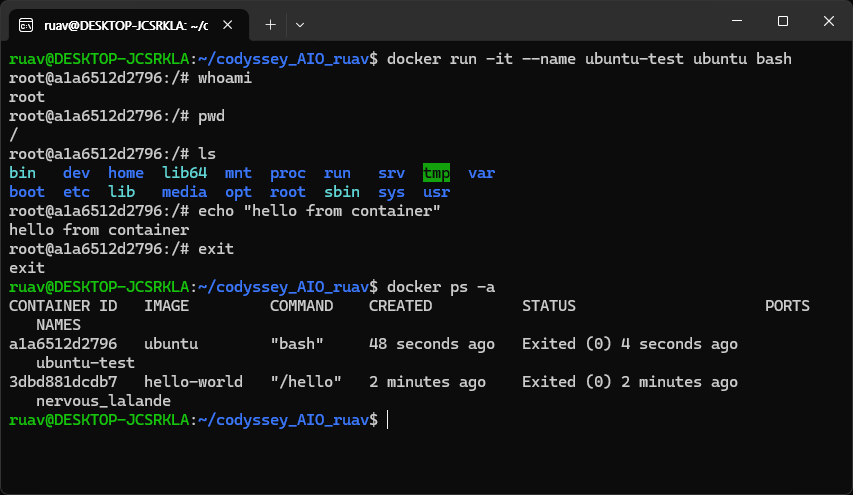

**확인 내용**

- 컨테이너 안에서도 Linux 명령이 동작하며, 호스트와 분리된 독립 환경이다.
- `exit`로 메인 프로세스(bash)가 끝나면 컨테이너는 `Exited` 상태가 된다.

#### 4-3-3. attach와 exec의 차이

**수행 목적**

실행 중인 컨테이너에 접근하는 두 방법의 차이를 직접 관찰.

**실행 명령어**

```bash
docker run -dit --name keep ubuntu bash   # 터미널을 켠 채 백그라운드 실행
docker ps

docker exec -it keep bash                 # 새 프로세스로 진입
exit
docker ps                                 # exec 종료 후 상태

docker attach keep                        # 메인 프로세스(PID 1)에 연결
exit
docker ps -a                              # attach 종료 후 상태
```

**실행 결과**

```text
ruav@DESKTOP-JCSRKLA:~/codyssey_AIO_ruav$ docker run -dit --name keep ubuntu bash
a64822d49366e16cb580e91214fa05a0b49ab0359ffd1c04b2ffb8777ddda440
ruav@DESKTOP-JCSRKLA:~/codyssey_AIO_ruav$ docker ps
CONTAINER ID   IMAGE     COMMAND   CREATED         STATUS         PORTS     NAMES
a64822d49366   ubuntu    "bash"    3 seconds ago   Up 3 seconds             keep
ruav@DESKTOP-JCSRKLA:~/codyssey_AIO_ruav$ docker exec -it keep bash
root@a64822d49366:/# exit
exit
ruav@DESKTOP-JCSRKLA:~/codyssey_AIO_ruav$ docker ps
CONTAINER ID   IMAGE     COMMAND   CREATED          STATUS          PORTS     NAMES
a64822d49366   ubuntu    "bash"    21 seconds ago   Up 21 seconds             keep
ruav@DESKTOP-JCSRKLA:~/codyssey_AIO_ruav$ docker attach keep
root@a64822d49366:/# exit
exit
ruav@DESKTOP-JCSRKLA:~/codyssey_AIO_ruav$ docker ps -a
CONTAINER ID   IMAGE         COMMAND    CREATED          STATUS                     PORTS     NAMES
a64822d49366   ubuntu        "bash"     34 seconds ago   Exited (0) 3 seconds ago             keep
a1a6512d2796   ubuntu        "bash"     5 minutes ago    Exited (0) 4 minutes ago             ubuntu-test
3dbd881dcdb7   hello-world   "/hello"   6 minutes ago    Exited (0) 6 minutes ago             nervous_lalande
```

| 구분 | 연결 대상 | `exit` 후 컨테이너 상태 (관찰) |
|---|---|---|
| `docker exec` | 컨테이너 안에서 **새로 실행한** 프로세스 | `[Up / Exited 입력]` |
| `docker attach` | 컨테이너의 **메인 프로세스(PID 1)** | `[Up / Exited 입력]` |

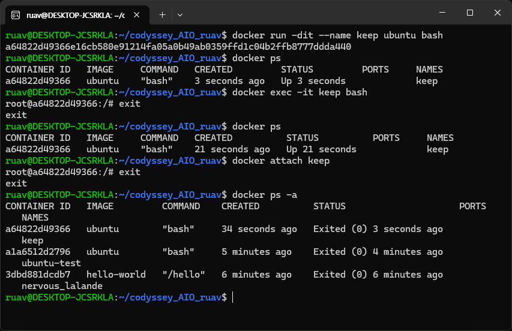

**확인 내용**

- `exec`의 `exit`는 새로 띄운 프로세스만 끝내므로 컨테이너가 유지된다.
- `attach`의 `exit`는 메인 프로세스를 끝내므로 컨테이너가 종료된다. (위 표의 관찰 결과로 확인)

---

### 4-4. Dockerfile 및 커스텀 이미지

#### 4-4-1. Dockerfile 및 웹 페이지 준비

**수행 목적**

기존 `nginx:alpine` 이미지(웹 서버 베이스 활용)에 내 웹 페이지와 설정을 더해 커스텀 이미지를 정의.

**실행 명령어**

```bash
cd ~/codyssey_AIO_ruav

cat > app/index.html <<'EOF'
<!DOCTYPE html>
<html lang="ko">
<head>
    <meta charset="UTF-8">
    <meta name="viewport" content="width=device-width, initial-scale=1.0">
    <title>My Custom Nginx</title>
</head>
<body>
    <h1>Hello, Docker!</h1>
    <p>My Custom Nginx Web Server</p>
</body>
</html>
EOF

cat > Dockerfile <<'EOF'
# Nginx Alpine 이미지를 기반으로 사용
FROM nginx:alpine

# 이미지 정보 설정
LABEL org.opencontainers.image.title="my-custom-nginx"

# 환경변수 설정
ENV APP_ENV=dev

# 웹 페이지 파일을 이미지 내부로 복사
COPY app/ /usr/share/nginx/html/

# 웹 서비스 포트
EXPOSE 80
EOF

cat Dockerfile
```

**실행 결과**

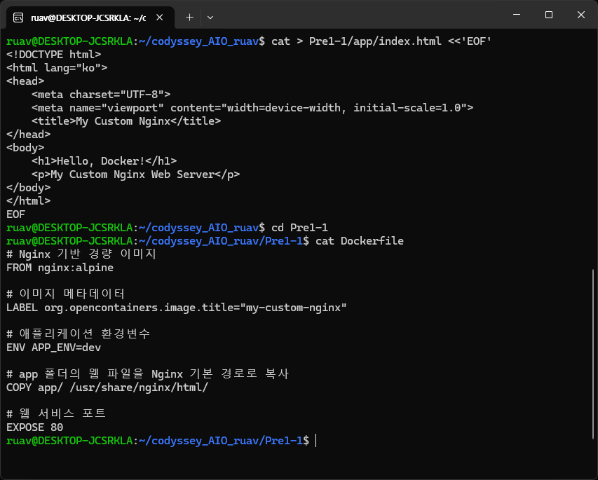

**확인 내용**

| 커스텀 포인트 | 적용 목적 |
|---|---|
| `FROM nginx:alpine` | 웹 서버가 포함된 가벼운 기존 이미지를 베이스로 사용 |
| `LABEL` | 이미지 이름 정보를 메타데이터로 기록 |
| `ENV APP_ENV=dev` | 실행 모드를 환경변수로 분리 (설정과 코드 분리) |
| `COPY app/ ...` | 직접 만든 HTML을 Nginx 웹 루트로 복사 |

#### 4-4-2. 이미지 빌드 및 검증

**수행 목적**

Dockerfile로 이미지를 빌드하고 커스텀 설정이 적용되었는지 확인.

**실행 명령어**

```bash
# 프로젝트 최상위 디렉터리에서 실행
docker build -t my-custom-nginx:1.0 .
docker images


**실행 결과**

```text
ruav@DESKTOP-JCSRKLA:~/codyssey_AIO_ruav/Pre1-1$ docker build -t my-custom-nginx:1.0 .
[+] Building 2.2s (7/7) FINISHED                                            docker:default
 => [internal] load build definition from Dockerfile                                  0.0s
.. 생략 .. 
 => [2/2] COPY app/ /usr/share/nginx/html/                                            0.0s
.. 생략 .. 
ruav@DESKTOP-JCSRKLA:~/codyssey_AIO_ruav/Pre1-1$ docker images
                                                                       i Info →   U  In Use
IMAGE                 ID             DISK USAGE   CONTENT SIZE   EXTRA
hello-world:latest    c567b231f656       25.9kB         9.49kB    U
my-custom-nginx:1.0   ccaecd6e08b5       93.6MB         26.3MB
ubuntu:latest         6a06111c3b0a        163MB         45.9MB    U
```

**확인 내용**

- 빌드가 성공해 `my-custom-nginx:1.0` 이미지가 생성되었다. (`-t`는 이름:태그, `.`은 빌드 컨텍스트)
- 컨테이너 실행은 4-5에서 확인한다.

---

### 4-5. 포트 매핑 및 웹 서버 접속

#### 4-5-1. 포트 매핑을 이용한 컨테이너 실행과 접속

**수행 목적**

컨테이너 내부의 웹 서버(80)에 호스트 포트를 연결해 브라우저와 `curl`로 접속.

**포트 매핑 구조**

```text
호스트(Windows / WSL)
       │
       │ 8080
       ▼
Docker 컨테이너
       │
       │ 80
       ▼
Nginx 웹 서버
```

포트 매핑은 호스트의 포트와 컨테이너 내부의 포트를 연결하는 기능입니다.

**실행 명령어**

```bash
docker run -d --name web-8080 -p 8080:80 my-custom-nginx:1.0
docker run -d --name web-8081 -p 8081:80 my-custom-nginx:1.0
docker ps

curl http://localhost:8080
curl http://localhost:8081

# 비교: -p 없이 실행
docker run -d --name no-port my-custom-nginx:1.0
docker ps                       # PORTS 열에 호스트 포트가 없는지 확인
curl http://localhost:80        # 접속 실패 예상 (나온 결과 그대로 기록)
```

브라우저 접속: `http://localhost:8080`, `http://localhost:8081` (주소창이 보이게 캡처)

**실행 결과**

```text
[docker ps 결과]
ruav@DESKTOP-JCSRKLA:~/codyssey_AIO_ruav/Pre1-1$ docker ps
CONTAINER ID   IMAGE                 COMMAND                  CREATED         STATUS         PORTS                                     NAMES
8ee46205a190   my-custom-nginx:1.0   "/docker-entrypoint.…"   3 seconds ago   Up 2 seconds   0.0.0.0:8081->80/tcp, [::]:8081->80/tcp   web-8081
3909c24fe9ce   my-custom-nginx:1.0   "/docker-entrypoint.…"   8 seconds ago   Up 8 seconds   0.0.0.0:8080->80/tcp, [::]:8080->80/tcp   web-8080
.. 생략 ..
ruav@DESKTOP-JCSRKLA:~/codyssey_AIO_ruav/Pre1-1$ docker ps
CONTAINER ID   IMAGE                 COMMAND                  CREATED          STATUS          PORTS                                     NAMES
81ff35976362   my-custom-nginx:1.0   "/docker-entrypoint.…"   6 seconds ago    Up 5 seconds    80/tcp                                    no-port
8ee46205a190   my-custom-nginx:1.0   "/docker-entrypoint.…"   38 seconds ago   Up 37 seconds   0.0.0.0:8081->80/tcp, [::]:8081->80/tcp   web-8081
3909c24fe9ce   my-custom-nginx:1.0   "/docker-entrypoint.…"   43 seconds ago   Up 42 seconds   0.0.0.0:8080->80/tcp, [::]:8080->80/tcp   web-8080
ruav@DESKTOP-JCSRKLA:~/codyssey_AIO_ruav/Pre1-1$ curl http://localhost:80
curl: (7) Failed to connect to localhost port 80 after 0 ms: Couldn't connect to server

[curl 결과]
ruav@DESKTOP-JCSRKLA:~/codyssey_AIO_ruav/Pre1-1$ curl http://localhost:8080
<!DOCTYPE html>
<html lang="ko">
<head>
    <meta charset="UTF-8">
    <meta name="viewport" content="width=device-width, initial-scale=1.0">
    <title>My Custom Nginx</title>
</head>
<body>
    <h1>Hello, Docker!</h1>
    <p>My Custom Nginx Web Server</p>
</body>
</html>
.. 생략 ..
```

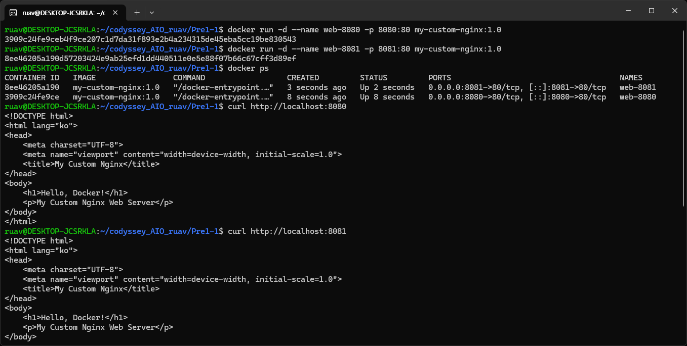
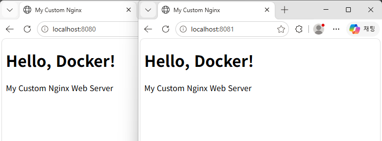

**확인 내용**

```text
브라우저/curl  →  호스트 8080  →  컨테이너 80  →  Nginx
```

- `-p 호스트:컨테이너`로 연결하면 호스트에서 컨테이너 내부 Nginx에 접속할 수 있고, `docker ps`의 `0.0.0.0:8080->80/tcp`로 연결 상태를 확인한다.
- 컨테이너 내부 포트는 둘 다 80이지만 호스트 포트를 다르게 해 동시에 접속할 수 있다.
- `-p` 없이 실행한 컨테이너는 호스트에서 접속되지 않는다. (포트 매핑이 필요한 이유 : 5번에서 설명)

---

### 4-6. 바인드 마운트 및 볼륨

#### 4-6-1. 바인드 마운트

**수행 목적**

호스트에서 수정한 파일이 재빌드 없이 컨테이너에 반영되는지 확인하고, `COPY`로 만든 컨테이너와 비교.

**실행 명령어**

```bash
cd ~/codyssey_AIO_ruav/Pre1-1          # WSL 파일시스템 경로에서 실행 (/mnt/c 아님)
docker run -d --name web-bind -p 8082:80 -v "$(pwd)/app:/usr/share/nginx/html" my-custom-nginx:1.0
docker ps

curl http://localhost:8082                                  # 변경 전
echo '<p>bind mount 수정 확인</p>' >> app/index.html
curl http://localhost:8082                                  # 변경 후
curl http://localhost:8080                                  # COPY 컨테이너는 그대로
```

**실행 결과**

```text
ruav@DESKTOP-JCSRKLA:~/codyssey_AIO_ruav/Pre1-1$ curl http://localhost:8082
<!DOCTYPE html>
<html lang="ko">
<head>
    <meta charset="UTF-8">
    <meta name="viewport" content="width=device-width, initial-scale=1.0">
    <title>Codyssey AIO - Docker 실습</title>
</head>
<body>
    <h1>Docker 커스텀 이미지 실행 성공!</h1>
    <p>Codyssey AIO - ruav 실습 페이지입니다.</p>
    <p>Nginx 컨테이너가 사용자 정의 HTML 페이지를 정상적으로 제공하고 있습니다.</p>
</body>
</html>
ruav@DESKTOP-JCSRKLA:~/codyssey_AIO_ruav/Pre1-1$ echo '<p>bind mount 수정 확인</p>' >> app/index.html
ruav@DESKTOP-JCSRKLA:~/codyssey_AIO_ruav/Pre1-1$ curl http://localhost:8082
<!DOCTYPE html>
<html lang="ko">
<head>
    <meta charset="UTF-8">
    <meta name="viewport" content="width=device-width, initial-scale=1.0">
    <title>Codyssey AIO - Docker 실습</title>
</head>
<body>
    <h1>Docker 커스텀 이미지 실행 성공!</h1>
    <p>Codyssey AIO - ruav 실습 페이지입니다.</p>
    <p>Nginx 컨테이너가 사용자 정의 HTML 페이지를 정상적으로 제공하고 있습니다.</p>
</body>
</html>
<p>bind mount 수정 확인</p>
```

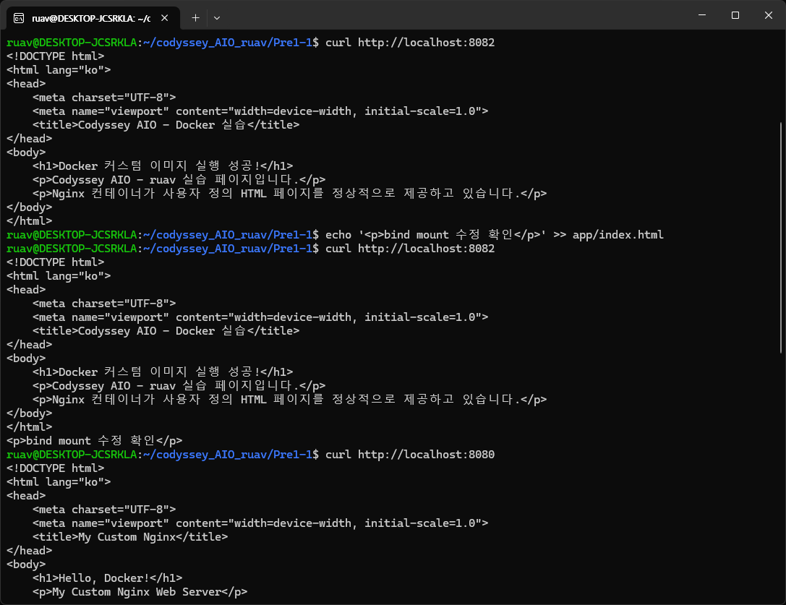

**확인 내용**

- 호스트에서 수정한 내용이 `web-bind`(8082)에는 바로 반영되고, `COPY`한 `web-8080`에는 반영되지 않았다.
- 이미지에 `COPY`된 내용을 바꾸려면 재빌드가 필요하다.

#### 4-6-2. Volume 생성 및 데이터 유지

**수행 목적**

컨테이너를 삭제해도 볼륨의 데이터가 유지되는지 확인. 볼륨 없이 실행한 경우와 대조.

**실행 명령어**

```bash
# 대조: 볼륨 없이
docker run -d --name no-vol ubuntu sleep infinity
docker exec no-vol bash -c "echo temp > /tmp/data.txt && cat /tmp/data.txt"
docker rm -f no-vol
docker run -d --name no-vol2 ubuntu sleep infinity
docker exec no-vol2 cat /tmp/data.txt          # 파일 없음 예상

# 볼륨 사용
docker volume create mydata
docker volume ls
docker run -d --name volume-test -v mydata:/data ubuntu sleep infinity
docker exec volume-test bash -c "echo 'Hello Docker Volume' > /data/hello.txt && cat /data/hello.txt"
docker rm -f volume-test
docker ps -a                                    # volume-test 삭제 확인
docker run -d --name volume-test2 -v mydata:/data ubuntu sleep infinity
docker exec volume-test2 cat /data/hello.txt    # 데이터 유지 확인
docker volume inspect mydata
```

**실행 결과**

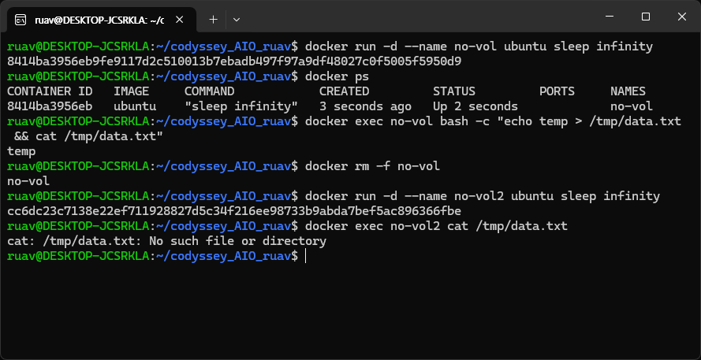
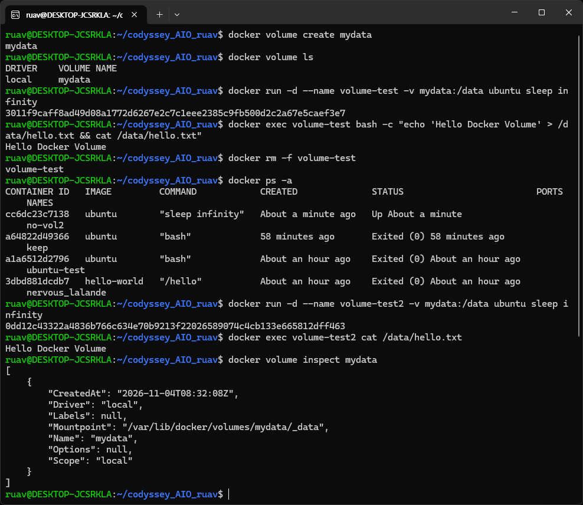

**확인 내용**

- 볼륨 없이 쓴 데이터는 컨테이너 삭제와 함께 사라지고, 볼륨에 쓴 데이터는 컨테이너를 삭제해도 새 컨테이너에서 그대로 확인되었다.

| 구분 | 바인드 마운트 | 볼륨 |
|---|---|---|
| 저장 위치 | 호스트의 지정한 경로 | Docker가 관리하는 저장 공간 |
| 연결 방식 | 호스트 경로를 직접 연결 | 볼륨 이름으로 연결 |
| 주요 용도 | 개발 중 파일 수정 즉시 반영 | 컨테이너와 독립적인 데이터 유지 |
| 이번 실습 | `app/` | `mydata` |

---

### 4-7. Git 및 GitHub 연동

#### 4-7-1. Git 기본 설정

**수행 목적**

커밋 작성자 정보와 기본 브랜치를 설정하고 확인.

**실행 명령어**

```bash
# 사용자 이름 설정
git config --global user.name "사용자이름"

# 이메일 설정
git config --global user.email "이메일주소"

# 기본 브랜치 이름 설정
git config --global init.defaultBranch main

# 설정 확인
git config --list
```

**실행 결과**

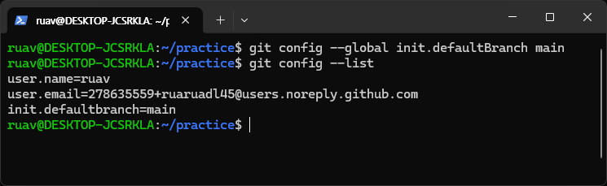

**확인 내용**

- `user.name`, `user.email`은 커밋 작성자 정보이며, GitHub 로그인과는 별개의 설정이다.
- 기본 브랜치가 `main`으로 설정되었다.

#### 4-7-2. 저장소 연결 및 GitHub 업로드

**수행 목적**

로컬 프로젝트를 Git 저장소로 만들고 GitHub 원격 저장소에 연결해 업로드.

**실행 명령어**

```bash
# 프로젝트 최상위 디렉터리로 이동
cd ~/codyssey_AIO_ruav

# Git 저장소 초기화
git init

# 원격 저장소 연결
git remote add origin https://github.com/ruaruadl45/codyssey_AIO_ruav.git

# 원격 저장소 연결 확인
git remote -v
```

**확인 내용**

- `git init`: 현재 디렉터리를 Git 저장소로 초기화
- `git remote add origin`: GitHub 원격 저장소 연결
- `git remote -v`: 연결된 원격 저장소 주소 확인

#### 4-7-3. 변경 사항 기록 및 GitHub 업로드

**실행 명령어**

```bash
# 변경된 파일 확인
git status

# 변경 사항 스테이징
git add .

# 변경 사항 커밋
git commit -m "Add development environment mission"

# 기본 브랜치를 main으로 설정
git branch -M main

# GitHub 원격 저장소에 업로드
git push -u origin main
```

**실행 결과**

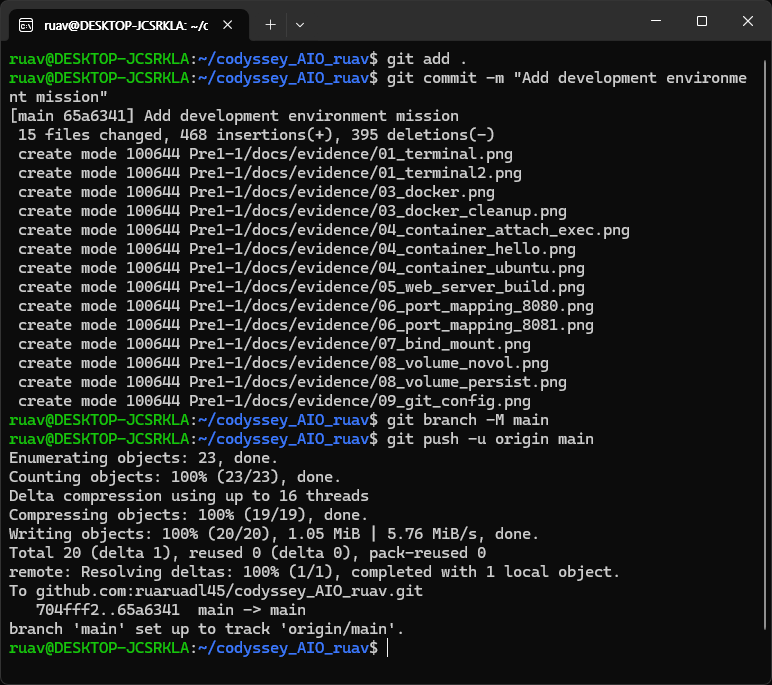

**확인 내용**

| 명령어             | 기능                         |
| --------------- | -------------------------- |
| `git status`    | 파일 변경 상태 확인                |
| `git add`       | 변경 파일을 스테이징 영역에 추가         |
| `git commit`    | 변경 사항을 로컬 저장소에 기록          |
| `git push`      | 로컬 저장소의 변경 사항을 원격 저장소에 업로드 |
| `git remote -v` | 원격 저장소 주소 확인               |

- `git add`(스테이징) → `git commit`(로컬 기록) → `git push`(원격 전송) 순서로 업로드했다.
- Git과 GitHub의 차이는 [5. 핵심 개념 정리](#5-핵심-개념-정리)에서 설명한다.

#### 4-7-4. VSCode 연동 및 업로드 확인

**수행 목적**

VSCode에서 GitHub에 로그인하고 저장소가 연동되었는지, GitHub에 파일이 올라갔는지 확인.

**실행 명령어**

```bash
cd ~/codyssey_AIO_ruav
code .                          # WSL 확장이 설치된 VSCode로 프로젝트 열기
```

VSCode 왼쪽 아래 계정 아이콘에서 GitHub에 로그인한 뒤 Source Control 화면을 확인합니다.

**실행 결과**

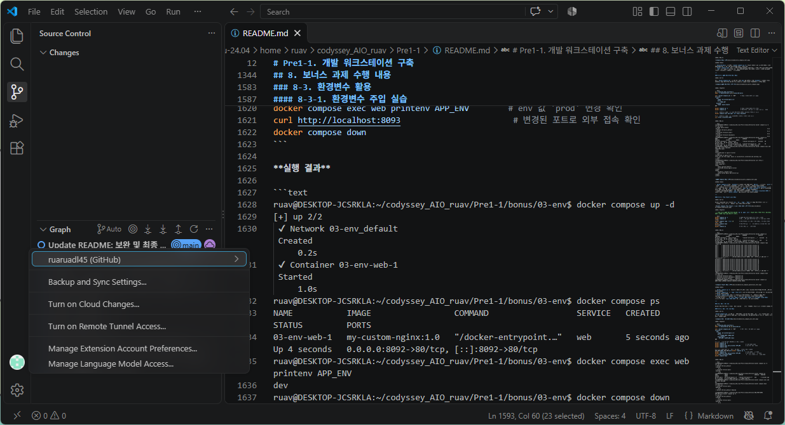
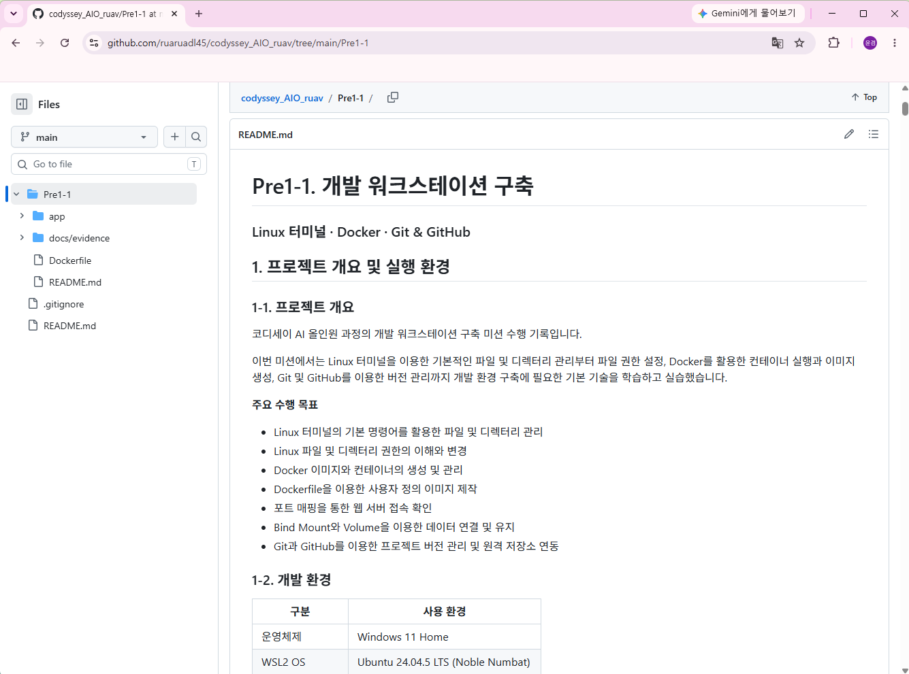

**확인 내용**

- VSCode에 GitHub 계정이 로그인되어 있고, Source Control에서 `main` 브랜치와 원격 저장소가 확인된다.
- GitHub 저장소 웹페이지에서 `README.md`, `Dockerfile`, `app/`, `docs/evidence/`가 보인다.

---

## 5. 핵심 개념 정리

이번 미션에서 학습한 주요 기술 개념을 정리합니다.

### 5-1. Linux 경로

- 절대 경로: 최상위 디렉터리부터 시작하는 전체 경로
- 상대 경로: 현재 작업 위치를 기준으로 지정하는 경로
- 홈 디렉터리: 사용자별 기본 작업 공간

### 5-2. Linux 파일 권한

Linux는 파일 및 디렉터리에 대해 소유자, 그룹, 기타 사용자별로 읽기·쓰기·실행 권한을 설정합니다.

| 권한    | 숫자 | 의미                     |
| ----- | -- | ---------------------- |
| 읽기(r) | 4  | 파일 내용 읽기               |
| 쓰기(w) | 2  | 파일 내용 수정               |
| 실행(x) | 1  | 파일 실행 또는 디렉터리 접근 관련 권한 |

자주 사용하는 권한은 다음과 같습니다.

- 755: 소유자는 모든 권한, 그룹과 기타 사용자는 읽기 및 실행 가능
- 644: 소유자는 읽기 및 쓰기 가능, 그룹과 기타 사용자는 읽기 가능
- 700: 소유자만 읽기, 쓰기 및 실행 가능

### 5-3. WSL2와 Docker의 관계

WSL2는 Windows 환경에서 Linux를 사용할 수 있도록 지원하는 기능입니다.

이번 실습에서는 Windows에 설치된 WSL2를 통해 Ubuntu를 실행하고, Ubuntu 터미널에서 Linux 명령어와 Docker 명령어를 사용했습니다.

**개발 환경의 연결 구조**

```text
Windows 11
    │
    ├── Visual Studio Code
    │
    └── WSL2
          │
          └── Ubuntu
                │
                ├── Linux 명령어 실행
                │
                ├── Git 명령어 실행
                │
                └── Docker 명령어 실행
                      │
                      └── Docker Container
```

- Windows: 기본 운영체제
- WSL2: Windows에서 Linux를 실행하는 환경
- Ubuntu: Linux 명령어를 실습하는 운영체제
- Docker: 컨테이너를 생성하고 관리하는 도구

### 5-4. Docker 이미지와 컨테이너

- 이미지(Image): 컨테이너를 생성하기 위한 실행 환경의 기반
- 컨테이너(Container): 이미지를 기반으로 실행되는 독립적인 환경
- Dockerfile: 이미지를 만들기 위한 설정 파일

### 5-5. 포트 매핑

호스트와 컨테이너 내부의 포트를 연결하여 외부에서 컨테이너의 서비스에 접근할 수 있도록 하는 기능입니다.

예를 들어 `-p 8080:80`은 호스트의 8080 포트를 컨테이너의 80 포트에 연결합니다.

### 5-6. Bind Mount와 Volume

- Bind Mount: 호스트의 특정 경로와 컨테이너 내부 경로를 직접 연결합니다.
- Volume: Docker가 관리하는 저장 공간을 컨테이너에 연결합니다.

두 방식 모두 컨테이너 내부에서 사용하는 데이터를 컨테이너 자체와 분리하여 관리할 수 있습니다.

### 5-7. Git과 GitHub

- Git은 프로젝트의 변경 이력을 관리합니다.
- GitHub는 Git 저장소를 온라인에서 관리하고 공유할 수 있도록 지원합니다.
- `add` → `commit` → `push` 순서로 변경 사항을 기록하고 원격 저장소에 업로드할 수 있습니다.

---

## 6. 트러블슈팅

문제가 발생했을 때 단순히 해결 방법만 기록하는 것이 아니라, 문제 상황과 확인 과정, 해결 방법을 순서대로 정리합니다.

### 6-1. WSL 설치 후 Linux 배포판이 없는 문제

**문제 상황**

WSL 설치 이후 Linux 배포판이 설치되지 않아 Ubuntu 터미널을 실행할 수 없는 상황이 발생했습니다.

**원인 추정**

WSL 기능은 설치되었지만 사용할 Linux 배포판이 설치되지 않은 상태로 판단했습니다.

**확인 명령어**

```powershell
wsl --status
wsl --list --verbose
wsl --list --online
```

**해결 명령어**

```powershell
wsl --install -d Ubuntu
```

**검증 명령어**

Ubuntu 실행 후 다음 명령어를 입력합니다.

```bash
whoami
pwd
```

**확인 결과**

- 사용자 이름: `ruav`
- 홈 디렉터리: `/home/ruav`

### 6-2. 추가 문제 해결 기록

| 구분    | 기록 내용              |
| ----- | ------------------ |
| 문제 상황 | [실제 발생한 문제 입력]     |
| 원인 추정 | [원인 또는 추정 내용 입력]   |
| 확인 방법 | [사용한 명령어 입력]       |
| 해결 방법 | [실제 해결 과정 입력]      |
| 최종 결과 | [해결 여부 및 확인 결과 입력] |

※ 실제 발생한 문제만 추가하여 기록합니다.

---

## 7. 재현 방법 및 보안 주의

### 7-1. 프로젝트 재현 방법

다른 환경에서도 동일한 프로젝트를 실행할 수 있도록 기본 절차를 정리합니다.

**0단계. 로컬 환경 셋팅(Docker, Git, VS Code 동시 설치 명령어)**
```bash
winget install --id Docker.DockerDesktop -e --accept-source-agreements --accept-package-agreements; winget install --id Git.Git -e --accept-source-agreements --accept-package-agreements; winget install --id Microsoft.VisualStudioCode -e --accept-source-agreements --accept-package-agreements
```

**1단계. GitHub 저장소 복제**

```bash
git clone https://github.com/ruaruadl45/codyssey_AIO_ruav.git
```

**2단계. 프로젝트 디렉터리 이동**

```bash
cd codyssey_AIO_ruav
```

**3단계. Docker 이미지 생성**

```bash
docker build -t my-custom-nginx:1.0 .
```

**4단계. 컨테이너 실행**

```bash
docker run -d \
  --name web-8080 \
  -p 8080:80 \
  my-custom-nginx:1.0
```

**5단계. 웹 서버 접속 확인**

```bash
curl http://localhost:8080
```

브라우저에서도 다음 주소로 접속하여 확인할 수 있습니다.

```text
http://localhost:8080
```

### 7-2. 재현 시 주의사항

- Docker가 정상적으로 실행 중이어야 합니다.
- 프로젝트 최상위 디렉터리에서 Dockerfile을 이용해 이미지를 생성해야 합니다.
- 호스트의 8080 포트가 이미 사용 중이라면 다른 포트로 변경해야 합니다.
- Bind Mount를 사용할 경우 실제 호스트 디렉터리 경로를 확인해야 합니다.
- WSL 환경에서는 Linux 파일 경로를 기준으로 작업하는 것이 편리합니다.

### 7-3. 보안 주의사항

GitHub에 프로젝트를 업로드할 때 다음 정보가 노출되지 않도록 주의합니다.

- 비밀번호
- 개인 액세스 토큰(Personal Access Token)
- SSH 개인 키
- 인증 코드
- 기타 계정 접근 정보

**SSH 키 사용 시 주의사항**

- 개인 키(`id_ed25519`)는 외부에 공개하지 않습니다.
- 공개 키(`id_ed25519.pub`)만 GitHub 등록에 사용합니다.
- 인증 정보가 포함된 파일은 저장소에 업로드하지 않습니다.

**Git 설정 정보 확인 시 주의사항**

```bash
git config --list
```

이 명령어로 확인되는 이메일 주소 등 개인정보가 공개되지 않도록 스크린샷을 촬영하거나 문서를 작성할 때 주의 해야합니다.

---

## 8. 회고

### 8-1. 학습 내용

이번 미션을 통해 Windows 환경에서 WSL2와 Ubuntu를 이용해 Linux 개발 환경을 구성하고, 터미널 명령어를 이용해 파일과 디렉터리를 관리하는 기본 방법을 익혔습니다.

또한 Linux 파일 권한의 개념을 학습하고, Docker를 이용해 이미지를 생성하고 컨테이너를 실행하는 과정을 실습했습니다.

Dockerfile을 직접 작성하여 사용자 정의 이미지를 생성하고, 포트 매핑을 통해 웹 서버에 접속하는 방법도 확인했습니다.

Bind Mount와 Volume 실습을 통해 컨테이너와 데이터를 분리하여 관리하는 방식의 차이를 이해했으며, Git과 GitHub를 연동하여 프로젝트 변경 사항을 관리하는 기본 흐름을 학습했습니다.

### 8-2. 어려웠던 점과 해결 과정

개발 환경을 처음 구축하는 과정에서 WSL 설치와 Ubuntu 배포판 설치의 차이를 이해하는 데 시간이 필요했습니다.

또한 Linux 터미널 명령어와 Docker 명령어가 각각 어떤 역할을 하는지 구분하고, 명령어 실행 결과를 확인하면서 단계별로 작업을 진행했습니다.

문제가 발생했을 때는 관련 명령어로 현재 상태를 확인하고, 확인된 결과를 바탕으로 다음 작업을 진행하는 방식으로 해결했습니다.

### 8-3. 추가 학습 계획

- Linux 파일 권한과 사용자·그룹 권한에 대한 이해 강화
- Docker 이미지 및 컨테이너 관리 명령어 반복 실습
- Docker Volume과 Bind Mount의 활용 방법 추가 학습
- Git 브랜치 및 협업을 위한 버전 관리 학습
- Docker Compose를 활용한 다중 컨테이너 관리 학습

---

## 9. 보너스 과제 (선택)

### 9-1. SSH 방식 GitHub 연동

SSH 키를 생성하고 공개 키를 GitHub에 등록하여 HTTPS 방식과 다른 인증 방법을 학습했습니다.

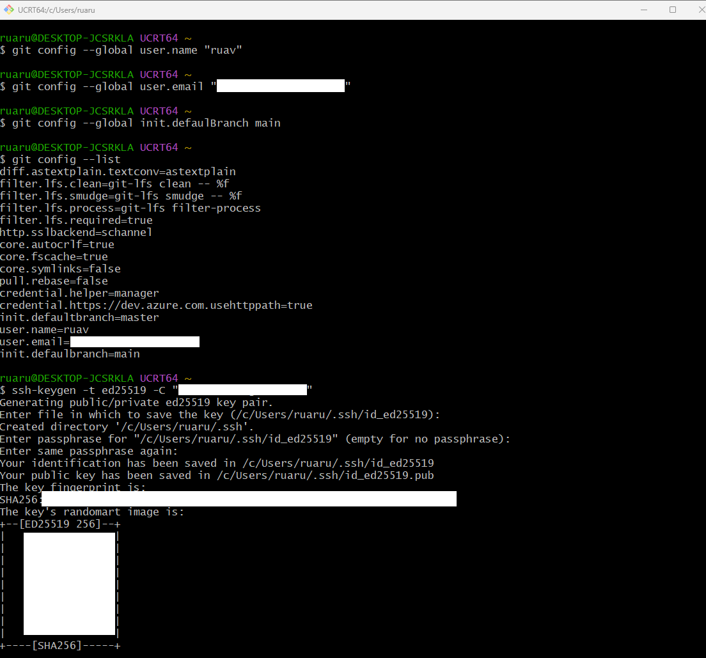
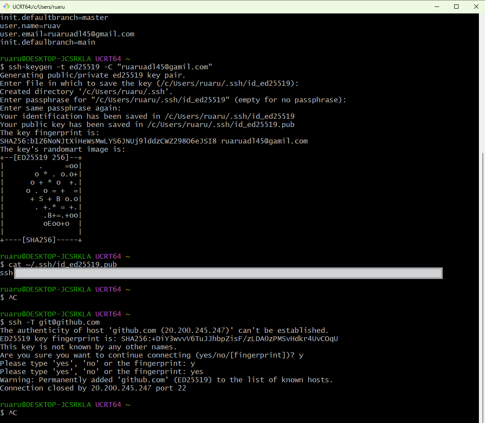
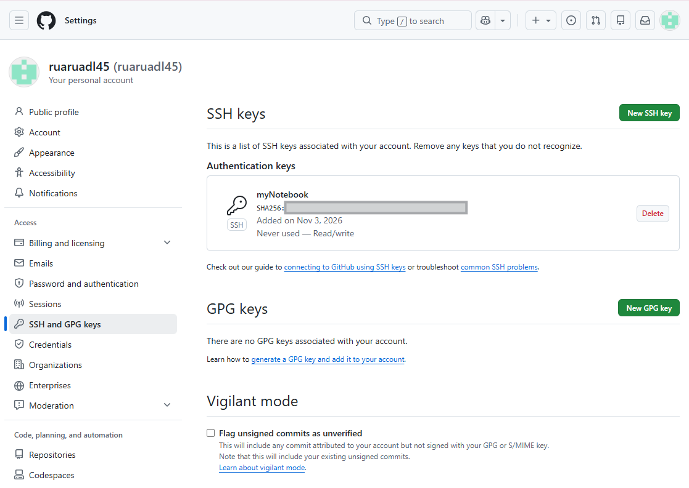

### 9-2. Docker Compose

여러 컨테이너의 실행 설정을 하나의 YAML 파일로 관리하고 함께 실행하는 방법을 학습합니다.

### 9-3. 환경변수 활용

Docker 컨테이너 실행 시 환경변수를 전달하고 애플리케이션에서 사용하는 방법을 학습합니다.

### 9-4. 추가 실습 기록

| 과제               | 수행 여부 | 결과 및 증거 자료   |
| ---------------- | ----- | ------------ |
| SSH 방식 GitHub 연동 | [ ]   | [기록 및 링크 입력] |
| Docker Compose   | [ ]   | [기록 및 링크 입력] |
| 환경변수 활용          | [ ]   | [기록 및 링크 입력] |

---

**문서 작성 기준**

- 실제 수행한 명령어와 결과를 기준으로 작성합니다.
- 확인되지 않은 항목은 완료로 표시하지 않습니다.
- 실행 결과가 긴 경우 표 안에 넣지 않고 코드 블록으로 작성합니다.
- 스크린샷은 `docs/evidence/` 디렉터리에 보관하고 해당 항목에 링크를 연결합니다.
- 개인정보, 인증정보 및 비밀번호는 문서와 스크린샷에서 가립니다.
